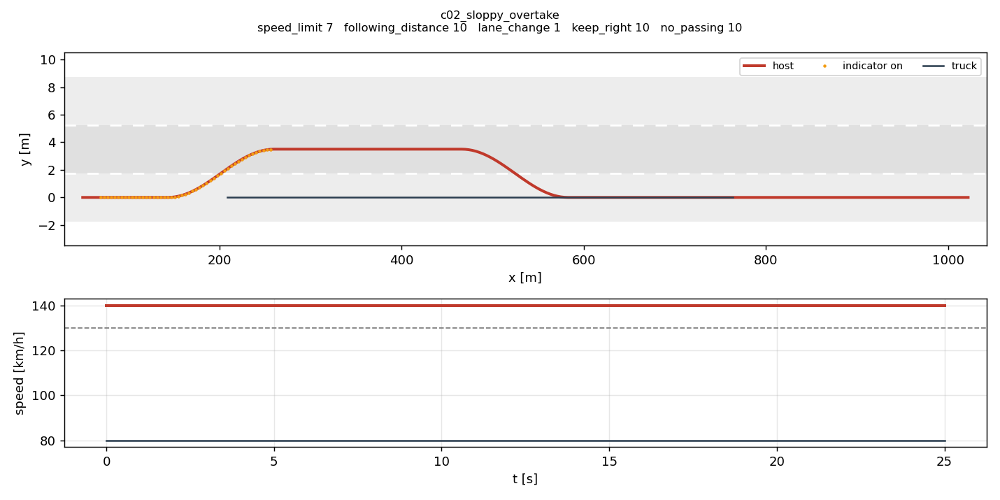

# drivecheck

Scores recorded driving scenarios against traffic rules (speed limit, following
distance, lane changes, overtaking, keep right, ...) and runs them as a
regression suite: every test case carries the score it is supposed to get, and
the run fails when a criterion drifts.

I built the first version of this idea in 2018 during my internship at the
BMW Group, where I maintained the regression tests of an internal tool that
rates simulated drives of automated driving functions. That code belongs to
BMW and is not in this repository. This is a clean reimplementation written
from scratch afterwards, in Python 3, with the lessons from the old pipeline
built in. See [docs/background.md](docs/background.md) for the story and
[docs/migration_notes.md](docs/migration_notes.md) for what went wrong in the
old runner and how it is handled here.



## What it does

- **8 criteria**, each giving a score from 1 (clear violation) to 10
  (compliant), or `n/a` when the scenario has nothing to judge. Scores are
  graded, not pass/fail, e.g. 105 km/h in a 100 zone scores 7, 145 km/h scores 1.
  Definitions are in [docs/criteria.md](docs/criteria.md).
- **Regression runner** that discovers test cases, runs each one in its own
  work folder, compares every criterion numerically (with optional tolerance)
  and reports all mismatches, not only the first one.
- **Two backends**: `replay` scores the recorded trajectories directly,
  `command` calls any external program (a simulator wrapped in a script, a
  docker run) with a timeout and reads the `results.csv` it writes.
- **Reports** per run: `summary.md`, `results.csv` and `junit.xml` for CI.
- **51 synthetic test cases** generated by
  [scripts/build_testcases.py](scripts/build_testcases.py). Expected scores are
  worked out by hand from the rule definitions.

No runtime dependencies beyond the standard library. Python 3.9 or newer.

## Quick start

```bash
git clone https://github.com/tejachirravuri/drivecheck.git
cd drivecheck
pip install -e ".[dev]"

drivecheck run                      # whole suite, replay backend
drivecheck run -k "no_passing/*"    # one group
drivecheck run -j 4                 # parallel
pytest                              # unit tests
```

Scoring a single scenario:

```
$ drivecheck evaluate testcases/combined/c02_sloppy_overtake/scenario.json
c02_sloppy_overtake (25.0 s, 251 frames)
  speed_limit              7  t=0.0s: 140 km/h in a 130 km/h zone
  following_distance      10
  time_to_collision       10
  minimal_distance        10
  lane_change              1  t=12.3s: lane 2 -> 1 without indicator
  road_departure          10
  keep_right              10
  no_passing              10
```

Using an external simulator instead of the replay backend:

```bash
drivecheck run --backend command \
    --command "bash run_sim.sh {input} {output}" -j 4
```

The command gets a fresh copy of the case folder as `{input}` and must write
`{output}/results.csv` with at least the columns `criterion,score`. A non-zero
exit code, a missing results file or running over `timeout_s` marks the case
as an error or timeout; the run carries on with the next case either way.
[examples/replay_as_command.py](examples/replay_as_command.py) is a small
stand-in that follows this contract.

## Test case layout

```
testcases/<group>/<case>/
    scenario.json   road + recorded trajectories (10 Hz)
    expected.csv    criterion,score,tolerance   (score may be n/a)
    case.json       description, timeout_s, criteria, params (optional)
```

Details and the scenario format are in [docs/testcases.md](docs/testcases.md).

## Results

All 51 cases pass with both backends on Python 3.10, 3.11 and 3.13; the
latest run is in [results/](results/summary.md). The unit tests (38) cover
the scoring tables, each criterion, the comparison logic and the runner
failure paths (timeouts, missing output, crashing criteria, paths with spaces,
cases with clashing file names).

## Project layout

```
src/drivecheck/
    model.py          road, lanes, actors, frames
    scenario.py       scenario file loader
    criteria/         the 8 criteria and shared scoring helpers
    engine.py         runs criteria on a scenario, reads/writes results.csv
    runner.py         discovery, comparison, per-case execution
    backends.py       replay and command backends
    report.py         markdown, csv and junit output
    cli.py            command line interface
scripts/              test case generator, scenario plot
testcases/            generated regression cases
tests/                pytest suite
docs/                 background, criteria, formats, migration notes
```

## License

MIT
